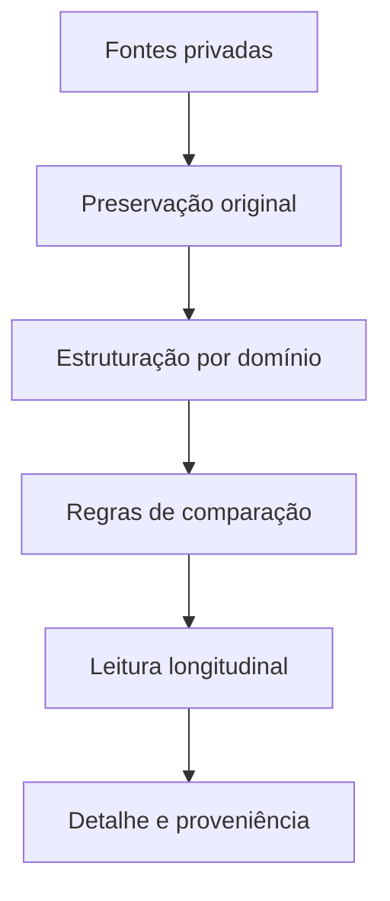

## Em validação — contagens singulares em Exames, candidata .119

A jornada móvel exata da .118 em Exames encontrou um defeito concreto de linguagem: quando havia apenas um marcador, o resumo mostrava “1 marcadores” e o seletor mostrava “1 encontrados”. `PKG-EXAMS-COUNT-COPY-035` / `LTS-EXAMS-COUNT-COPY-001` aplica a pluralização compartilhada somente a essas duas contagens e adiciona contrato para um marcador com dois resultados.

A correção não altera resultados, datas, unidades, laboratório, método, referência, comparação, original, paginação, banco ou autenticação. Os nove bloqueios externos, as duas lacunas aceitas e as duas alternativas substituídas permanecem independentes. Candidata `health-integrated-20261102.119`; publicação, artefatos responsivos e inspeção exata ainda não contam como aprovados.

# Concluído — recebimento de arquivos e leitura de Dados e fontes, .113

`PKG-UPLOAD-RECEIPT-028` / `LTS-UPLOAD-RECEIPT-UX-001` está concluído. O envio mantém o resultado visível após atualizar a tela, conserva a escolha anterior em redesenhos da mesma rota e bloqueia envios duplicados enquanto termina. Arquivo incorporado, original guardado e falhas parciais têm mensagens distintas; a situação/formato confirmados são preservados ao sair da área e voltar. Saída/troca de conta limpa recebimento e propriedade da escolha. Ações de envio/backup têm 48 px, confirmação/histórico são legíveis e os títulos/explicações do inventário ficam em linhas separadas, com contagens preservadas.

PR476: candidata `491322b1197f2c375f97165f3a93b99cc77f8cbf`, 54/54 cenários completos Chromium/WebKit em 320/393/1440 px. Artefato sintético `13085553906`, `sha256:15eb760350cfa2ccf6955af146c6a904c325a4cad836b2bf99651ee99ea93142`, conferido por hash e imagens legíveis. Merge normal `a54771300abf7e571847f0ae1b177670cc7638a6` tem a árvore exata testada. Cloud Browser confirmou `.113`, login desconectado, área privada oculta e 1363/1363 px; autenticação real protegida, deploy e smokes públicos passaram como evidências separadas. Sem nova validação física de iPhone ou sessão privada manual presumida. Snapshot observado: candidata 18/18 e publicação de runtime 20/22; repetições ainda em andamento são listadas no estado e não contam como sucesso.

A rodada seguinte também terminou: `PKG-LEGACY-PR-RECONCILIATION-029` / `LTS-LEGACY-PR-RECONCILIATION-001`. PR348/354 foram encerrados por supersessão, com branches/histórico preservados. PR367 teve 25 arquivos e 820 imagens de linhas inventadas revisados; 6/6 verificações frescas passaram antes do merge normal `e381ba7eeb369e6bc66b39568b111276c056dc6c`. A subárvore v2 ficou byte a byte idêntica à .113; não houve aplicação de proposta clínica ou alteração do banco real.

Fila: 102 concluídos, 14 bloqueios externos e 2 lacunas aceitas, zero ready/in_progress. O manifesto original das quinze correções não foi recuperado pela busca delimitada e as demais dependências genuínas permanecem abertas. A automação segue habilitada, sem PR/deploy para QA sem mudança. Próxima área de UX: Nutrição; aceite global continua independente.

# Histórico da preparação e das evidências anteriores

# Em validação — recebimento de arquivos preservado na tela, .113

`PKG-UPLOAD-RECEIPT-028` / `LTS-UPLOAD-RECEIPT-UX-001` corrige uma falha concreta: o envio mantinha referências à mensagem e ao botão que a própria atualização da tela removia. O resultado final podia desaparecer e o formulário novo perdia o bloqueio de envio em curso. A candidata conserva o recebimento e a ocupação em memória, preserva a escolha anterior ao envio em redesenhos da mesma rota e distingue arquivo incorporado, guardado para leitura e falhas parciais. Somente situação/formato retornados pelo processamento são retidos; não são projetadas amostras ou conteúdo bruto.

A mensagem final tem pelo menos 14 px, recebe foco quando a pessoa continua na área e não retoma uma rota abandonada. Saída ou troca de conta limpa o recebimento e impede sua reaparição tardia. Origem, destino privado, autenticação, banco, regras clínicas e parser laboratorial continuam com suas fronteiras existentes. Testes locais de transporte e contratos passaram; navegador, imagens exatas e publicação permanecem pendentes. O pacote não está concluído e os 14 bloqueios externos e 2 lacunas independentes permanecem reais. Não pedir novamente os testes de iPhone já feitos nem criar dados para fechar pendências.

Publicação .112 — situação de água com acesso contextual de uso único, foco após o último reposicionamento, avisos e configuração legíveis e ação principal de recebimento. Sem mudança de dados, origem ou confirmação de continuidade automática.

Atualização de navegação de fontes — 01/11/2026: o atalho contextual da água abre e foca seu recebimento em Dados e fontes após o carregamento; o contexto vale uma vez. A consulta comum mantém o início da página. A situação da água fica separada do recebimento geral; ajustes técnicos permanecem em detalhes secundários com as confirmações existentes.

Atualização de água/energia — 01/11/2026: uma janela sem água não termina em vazio sem saída. A Home mostra o último valor genuíno da origem quando existir e oferece registro manual confirmado e diagnóstico de sincronização no próprio cartão; ausência nunca vira zero. Energia ativa pode exibir soma dos dias registrados de uma única origem, sempre separada do gasto energético total e com cobertura explícita. Gasto total só aparece a partir de série total explícita; basal não é somado por inferência.

Atualização de navegação — 01/11/2026: quando uma área especializada é aberta por uma ação contextual, o retorno deve preservar a origem uma vez; a entrada direta mantém seu destino canônico. Em Relatórios, Ver treinos → Voltar retorna ao relatório; Treinos aberto diretamente → Voltar retorna à Home. O contexto não altera dados, filtros, fontes ou autenticação.

Atualização de autoridade — 27/10/2026: o proprietário rejeitou a .91 como informações espalhadas. A abertura deve responder estado conhecido, mudança e pontos para acompanhar, com cinco domínios datados e ações para seus históricos. Texto de sincronização, algoritmo de seleção de fontes e comparações extensas são detalhes secundários. As sete métricas diárias, período/dia, escolhas explícitas de origem e limites dos dados continuam íntegros. Esta exigência substitui prioridades anteriores que faziam contagens e linguagem operacional dominar a Home.

# LTS Health — arquitetura canônica de produto

Status: fonte de verdade de produto. Este documento registra o que o LTS Health precisa resolver, como as áreas se relacionam e quais perguntas cada tela deve responder. Não contém dados pessoais de saúde.

## Tese do produto

O LTS Health é um **assistente longitudinal privado de saúde**, apoiado por evidências registradas. Ele reúne fontes fragmentadas, preserva a origem de cada dado e transforma o histórico em uma leitura simples:

1. o que está documentado agora;
2. o que mudou no período;
3. quão completa e confiável é essa leitura;
4. onde aprofundar ou completar dados.

O usuário não deve precisar conhecer arquivos, parsers, tabelas ou regras internas para obter essa resposta. Nutricionista, treinador e profissional de saúde autorizado devem conseguir chegar à evidência original sem perder o contexto longitudinal.

## O que o produto não é

- uma coleção de cards independentes;
- um repositório de arquivos apresentado como dashboard;
- uma planilha que transfere ao usuário a revisão técnica de dados;
- um sistema que preenche lacunas, combina origens ou atribui causalidade por suposição;
- uma ferramenta de diagnóstico, prescrição, meta corporal ou julgamento estético.

## Perguntas que orientam a experiência

Toda informação visível deve responder pelo menos uma destas perguntas:

| Pergunta | Resposta esperada |
| --- | --- |
| Como está o histórico conhecido? | Último estado documentado por domínio, com data e origem quando relevantes. |
| O que mudou? | Comparação entre pontos compatíveis ou indicação clara de que não há comparação segura. |
| Essa leitura é completa? | Cobertura, ambiguidade, falha ou ausência sem transformar lacuna em zero. |
| O que merece revisão? | Poucas prioridades explicadas em linguagem comum, com ação direta. |
| De onde veio? | Caminho curto até fonte, registro e evidência preservada. |

## Arquitetura de informação

### Navegação primária

| Grupo | Área | Trabalho principal |
| --- | --- | --- |
| Acompanhar | Visão geral | Entender estado, mudança, cobertura e prioridades da janela. |
| Acompanhar | Timeline | Percorrer eventos de todos os domínios em ordem temporal. |
| Áreas | Treinos | Ir de ritmo e progressão para sessão, exercício e série. |
| Áreas | Composição | Comparar medições compatíveis e abrir detalhe corporal/segmentar. |
| Áreas | Nutrição | Ver cobertura e histórico registrado, incluindo hidratação. |
| Áreas | Exames | Explorar coletas e séries comparáveis por marcador, origem e unidade. |
| Contexto | Recuperação e análises | Ler sono, atividade e relações temporais sem confundir associação com causa. |
| Contexto | Protocolos | Consultar contexto histórico sem inferir situação atual ou orientar uso. |
| Sistema | Dados e fontes | Conectar, importar, acompanhar processamento, qualidade e backup. |

`Evolução` deixa de ser uma seção primária concorrente. Suas capacidades pertencem a Composição e Treinos; a rota antiga continua funcional durante a transição para preservar links.

### Hierarquia da Visão geral

A abertura deve ser uma superfície de decisão reconhecível como a primeira tela da referência aprovada. No mobile, a ordem é:

1. **Contexto pessoal:** marca, saudação, data e uma frase curta.
2. **Composição compacta:** peso, gordura e massa magra, com comparação somente quando segura.
3. **Hoje:** treino, tratamentos, hidratação e alimentação do dia atual, sem promover registros históricos.
4. **Progresso semanal:** quatro indicadores compactos de cobertura recente.
5. **Evolução longitudinal:** um gráfico principal com quatro períodos e oito métricas selecionáveis.
6. **Aprofundamento:** seis domínios em faixa horizontal, acontecimentos recentes e contexto das fontes.

No desktop, seguir a referência executiva reenviada em 06/10: cinco cartões de domínio → leitura principal → treino/nutrição/composição → sono/exames/água → resumo/revisões/fontes. Os módulos compartilham calendário, não origens ou unidades. No celular, manter Hoje e cobertura semanal antes da evolução. Calendário cruzado, evidências e acontecimentos ficam em aprofundamento progressivo; o detalhe continua nas áreas especializadas. Não esticar a composição mobile para ocupar o desktop.

## Contrato de cada área

Cada tela especializada segue a mesma progressão:

1. **Resumo:** estado conhecido e período aplicado.
2. **Mudança:** diferença segura, ou motivo objetivo para não comparar.
3. **Tendência:** série temporal apenas quando datas, unidades e origens forem compatíveis.
4. **Detalhe:** registro e proveniência.
5. **Cobertura:** ausências, conflitos e falhas separados de valores reais.

## Modelo mental dos dados

- A fonte original nunca é substituída pelo resumo.
- Uma linha estruturada só participa de comparação quando passa pelas regras do domínio.
- Evidência complementar pode enriquecer um evento, mas não cria duplicação automática.
- Ambiguidade, ausência e falha são estados diferentes e permanecem visíveis.

## Estados de interface

| Estado | Linguagem do produto | Regra |
| --- | --- | --- |
| Carregando | “Carregando esta área” | Não apagar dados já disponíveis. |
| Disponível | Valor + data/contexto | Mostrar somente evidência autorizada. |
| Parcial | “Parte dos dados não carregou” | Preservar o restante da área. |
| Ausente | “Sem registro” | Nunca renderizar zero implícito. |
| Ambíguo | “Revisão necessária” | Não escolher automaticamente um candidato. |
| Bloqueado | Próxima ação e motivo | Distinguir ação humana de dependência externa. |

## Princípios de UX

- linguagem de usuário, sem jargão de implementação;
- texto principal com pelo menos 16 px e rótulos regulares com pelo menos 14 px;
- ações específicas, como “Abrir treinos” ou “Revisar cobertura”, evitando repetição de “Ver mais”;
- navegação agrupada por intenção, sem áreas redundantes competindo pelo mesmo trabalho;
- desktop com rail escuro e canvas claro; mobile com conteúdo claro e navegação que não cobre a página;
- cor comunica domínio ou estado, não decoração;
- vazios explicam o que falta e oferecem uma ação somente quando ela existe;
- nenhum fluxo histórico exige digitação dia a dia quando uma transferência em lote é tecnicamente possível.

## Critério de produto concluído

Um pacote só pode ser chamado de concluído quando reúne quatro evidências diferentes:

1. aderência a esta arquitetura e ao `FEEDBACK_LEDGER.md`;
2. comportamento e dados protegidos por contratos automatizados;
3. inspeção visual real em desktop e celular;
4. confirmação de deploy público quando a interface publicada muda.

CI verde comprova regressões técnicas cobertas. Ele não comprova, isoladamente, que o produto corresponde ao briefing ou à referência visual.

Para uma entrega visual, “confirmação de deploy” significa abrir o link público final em navegador remoto, autenticar quando possível, navegar pela interface real e inspecionar as superfícies afetadas em desktop e mobile. Screenshot de CI pode complementar essa verificação, mas não substitui a abertura do produto publicado.

Para mudanças mobile, o conjunto mínimo inclui viewport cheio e viewport reduzido de navegador (`393 × 650`). O shell não pode reservar espaço para elementos ocultos nem somar padding de navegação quando a navegação já ocupa uma linha própria.

## Referência visual e precedência atual

A imagem aprovada em 04/09/2026 foi recuperada e está preservada fora do repositório público no Drive privado do proprietário como `LTS Health - referencia visual aprovada.png`, SHA256 `dc322921f2d05d26f6478d213a6e3a2317978fba62897a77df4dda29d03cc05c`. O contrato textual correspondente está em `REFERENCE_VISUAL_CONTRACT.md`.

- a imagem privada é a autoridade visual mobile e deve ser recuperada antes de qualquer redesenho;
- o contrato textual ajuda a proteger estrutura e semântica, mas não pode contrariar a imagem;
- nenhuma comparação autoriza copiar valores, metas ou exemplos ilustrativos para dados reais;
- nenhum pacote pode declarar paridade pixel ou aceite sem comparação visual efetiva e decisão explícita do proprietário.

## Fontes usadas nesta consolidação

- histórico de decisões e feedbacks recuperado do projeto;
- `HANDOFF_LTS_HEALTH.md`, `MIGRATION_MANIFEST.md` e a implementação original fornecida;
- código, testes, migrations, issues e pull requests existentes;
- `PROJECT_BRIEF.md`, `PRODUCT_VISION_COCKPIT.md`, `REFERENCE_VISUAL_CONTRACT.md` e `DATA_AUDIT.md`.

